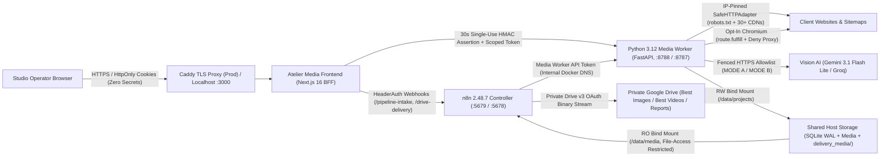
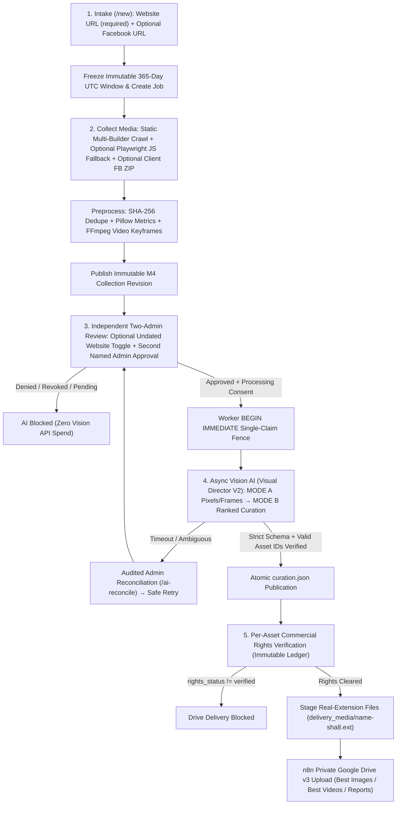
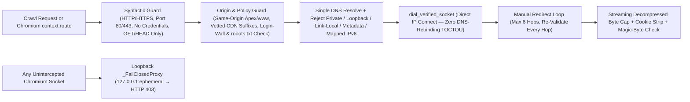

# Atelier Media — Pet Grooming Media Intelligence (V2.1)

[](https://github.com/rashidtesting8-ops/Insta-Fb-Media-Collector/actions/workflows/tests.yml)


A self-hosted, open-source **media collection, AI visual curation, commercial rights governance, and private Google Drive delivery platform** purpose-built for pet grooming studios and non-technical operators.

An operator enters a client's **Website URL** (with optional **Facebook Page URL**; Instagram is optional and parked — **zero Meta API dependency**). The platform discovers and downloads publicly permitted photos and videos within an immutable **365-day UTC window**, hydrates JS-rendered SPA galleries safely when needed, ingests optional **client-supplied Facebook Export ZIPs**, enforces **independent Two-Admin M4 approval**, runs **Visual Director V2** multimodal Vision AI (**Gemini 3.1 Flash Lite** or **Groq Vision**) on real pixels and FFmpeg video keyframes, requires explicit **per-asset commercial rights verification**, and delivers rights-cleared originals with clean filenames and native image/video thumbnails to a **private Google Drive folder** via n8n.

> [!IMPORTANT]
> **Engineering honesty and compliance first.** This platform never fabricates coverage percentages, publication dates, or legal reuse rights. Platform blocks (`robots_disallowed`, `subpage_restricted`, `restricted`, `rate_limited`), undated website media (`unknown_date`), and unverified usage rights (`rights_status: "unverified"`) are recorded explicitly and surfaced in plain English on the operator dashboard. No CAPTCHA evasion, no `robots.txt` bypass, no cookie/session smuggling, and no fake completion states.

---

## Table of Contents

- [1. Verified Capabilities & Honest Boundaries](#1-verified-capabilities--honest-boundaries)
- [2. System Architecture & Trust Boundaries](#2-system-architecture--trust-boundaries)
- [3. End-to-End 5-Step Pipeline & Governance State Machine](#3-end-to-end-5-step-pipeline--governance-state-machine)
- [4. Security, SSRF & Compliance Architecture](#4-security-ssrf--compliance-architecture)
- [5. Repository Structure](#5-repository-structure)
- [6. Technology Stack](#6-technology-stack)
- [7. Localhost Quick Start](#7-localhost-quick-start)
- [8. API & Webhook Reference](#8-api--webhook-reference)
- [9. Automated Testing, CI Gates & Ops Tooling](#9-automated-testing-ci-gates--ops-tooling)
- [10. Production VPS Deployment Path](#10-production-vps-deployment-path)
- [11. Documentation Index & Provenance](#11-documentation-index--provenance)

---

## 1. Verified Capabilities & Honest Boundaries

Every status row below reflects what is **built, automated-tested, and live-verified** on `main`, alongside real-world external platform limits.

| Capability | Status | Verified Implementation & Honest Boundaries |
| --- | --- | --- |
| **Universal Website Collection** | **Live-verified** | Multi-builder crawler (`website_inventory.py`, `public_collection.py`, `legacy_collector.py`) with HTTPS-443 allowlist for **30+ builder & managed CDNs** (Wix, Squarespace/sqspcdn, Shopify, Webflow, Framer, WordPress/Jetpack, GoDaddy, Duda, GoHighLevel, Weebly/Square, Cloudinary, Imgix, CloudFront, BunnyCDN, Fastly, Contentful, Sanity, Prismic, S3/GCS). Supports apex ↔ `www.` redirects, Yoast/WP XML comment sitemaps (blocking DTD/XXE), gallery-first link prioritization, Shopify auth/app-proxy route exclusions, fault-isolated subpage restriction handling (`subpage_restricted`), and static builder JSON extraction. Undated site assets remain honestly tagged `unknown_date` (`Website · Date unverified`) until explicitly included per job. |
| **SSRF-Hardened Playwright JS Fallback** | **Live-verified (Chromium E2E)** | Opt-in bounded headless Chromium fallback (`browser_renderer.py`, enabled via `INSTALL_PLAYWRIGHT=1` & `PLAYWRIGHT_FALLBACK_ENABLED=1`) that automatically triggers on SPA/JS pages yielding `< 3` static assets. Eliminates redirect & DNS-rebinding SSRF (`route.continue_()` is never called; every allowed `GET`/`HEAD` request flows through IP-pinned `SafeHTTPAdapter` + `route.fulfill()` alongside an in-process loopback `HTTP 403` fail-closed deny proxy). Extracts hydrated ``, `<video>`, and computed CSS `background-image` URLs while honoring `robots.txt` pre- and post-navigation. |
| **Website-Only or Website + Facebook Intake** | **Live-verified** | `website_url` is required; `facebook_url` and `instagram_url` are optional (`instagram` parked by default). `gallery-dl 1.32.20` (+ `yt-dlp` fallback) discovers public Facebook post URLs and timestamps. **Honest limit:** `scontent.*.fbcdn.net/robots.txt` returns `Disallow: /`, so anonymous automated Facebook binary downloads are refused and reported truthfully as `robots_disallowed`. |
| **Client Facebook Export ZIP & Media Upload** | **Built & offline-tested** | Zero-Meta-API, 100% compliant path for 365-day Facebook photos and videos (`POST /api/jobs/[id]/media-upload`). Enforces size/count caps (`100 MB` upload / `25 MB` per file / `150 MB` uncompressed / `60` files), blocks zip-slip, symlinks, and encrypted ZIP entries, verifies magic bytes, parses official Facebook JSON `creation_timestamp` & captions, enforces the frozen 365-day UTC window, deduplicates by SHA-256, runs Pillow + FFmpeg preprocessing, and atomically publishes a new M4 revision. |
| **Preprocessing & Quality Metrics** | **Live-verified** | Deterministic SHA-256 deduplication across sources, Pillow resolution/aspect/blur metrics, and bounded FFmpeg video keyframe extraction with frame timestamps. Videos evaluated via keyframes are never mislabeled as full-video review. |
| **Two-Admin M4 Governance & Auth** | **Live-verified** | Argon2id (`libsodium23`) Named Admin accounts, HttpOnly signed session cookies (`__Host-` on HTTPS), 30-second single-use HMAC assertions (`X-Named-Assertion`), immutable SQLite `UPDATE`/`DELETE` trigger-protected approval & rights ledgers, and actor-separation checks before AI execution. |
| **Multi-Provider Vision AI (`Visual Director V2`)** | **Live-verified (Gemini & Groq)** | Two-stage multimodal pipeline (`MODE A` per-asset pixel/keyframe scoring → `MODE B` ranked collection curation) executing [`docs/AI_VISUAL_DIRECTOR_V2.md`](docs/AI_VISUAL_DIRECTOR_V2.md) with strict `extra="forbid"` Pydantic schemas and hallucinated-ID rejection. Verified live on **Gemini 3.1 Flash Lite** (`AI_TIER_PRESET=gemini`, `reasoning_effort="none"`, `5 img/req`) and **Groq** (`qwen/qwen3.8-27b`, `on_demand` / `dev` presets). Includes startup crash recovery and an audited Named Admin reconciliation flow (`POST /api/jobs/[id]/ai-reconcile`) for timed-out/ambiguous attempts. |
| **Commercial Rights Gate & Private Google Drive Delivery** | **Live-verified (`Best Images/`, `Best Videos/`, `Reports/`)** | Every asset defaults to `rights_status: "unverified"`. Cleared assets are staged via hardlink/copy with SHA-256 verification under `delivery_media/<clean-stem>-<sha8>.<ext>` so n8n detects exact MIME types (`image/webp`, `image/jpeg`, `image/png`, `video/mp4`) and Google Drive displays native thumbnails inside private (`Restricted`) `Best Images/`, `Best Videos/`, and `Reports/` folders. `06-google-drive-delivery.json` enforces HTTP `502` error gating (no silent `200` masking). |
| **Atelier Media Guided Studio UI** | **Live on localhost** | Next.js 16 (`React 19`, `Tailwind CSS 4`) 5-step guided workspace (`Collect Media` → `Admin Review` → `AI Selection` → `Rights Check` → `Drive Delivery`) with live AI status/error alerts, 1-click website photo inclusion, Quick Approve, copyable teammate review links, 1-click AI reconciliation, plain-English error translation (`errors.ts`), non-destructive polling with backoff, dashboard pagination, and live Settings readiness (including Chromium JS fallback status). |
| **Production VPS Packaging** | **Prepared; pre-VPS hardening tracked** | Includes `deploy/compose.staging.yml`, `deploy/compose.prod.yml`, `deploy/Caddyfile.prod`, `deploy/vps-bootstrap.sh`, `deploy/systemd/*`, `sqlite_backup.py`, `readiness_probe.py`, and `prod_preflight.py`. Currently validated on localhost; see [Section 10](#10-production-vps-deployment-path) for pre-VPS launch checks. |

---

## 2. System Architecture & Trust Boundaries

The system maintains a strict **three-layer separation of duties** with zero split-brain orchestration and zero credentials exposed to the browser:



### Strict Layer Ownership Contract

| Layer | Owns | Explicitly Does NOT Own |
| --- | --- | --- |
| **Atelier Media Frontend (`frontend/`)** | Non-technical 5-step operator UX, session cookies, CSRF/Origin checks, server-side BFF proxies, 30s HMAC signing (`X-Named-Assertion`), multipart upload framing | Direct DB access, direct external scraping, direct Vision AI calls, browser-exposed API tokens |
| **n8n Orchestrator (`n8n-media/`)** | Intake validation webhooks (`07`), status/health probes (`00`, `05`), Google Drive v3 OAuth folder/subfolder provisioning and binary file streaming (`06`) | Vision AI execution, raw web crawling, RW storage mutations, `$env` expression reads (`N8N_BLOCK_ENV_ACCESS_IN_NODE=true`) |
| **Python Media Worker (`services/media-worker/`)** | Durable SQLite (WAL) job store & immutable M4 ledgers, 365-day checkpointed website/social collection, SSRF-hardened Playwright fallback, ZIP/media ingest, Pillow/FFmpeg preprocessing, worker-fenced async Vision AI V2, real-extension Drive delivery staging | Public internet exposure, OAuth token storage, browser session rendering |

---

## 3. End-to-End 5-Step Pipeline & Governance State Machine



---

## 4. Security, SSRF & Compliance Architecture

### IP-Pinned SSRF & Playwright Zero-Socket Defense

Every external website crawl and every opt-in headless Chromium render passes through a single verified network boundary:



### Core Security Controls Verified on `main`

- **SSRF & Crawl Isolation:** `SafeHTTPAdapter` + `dial_verified_socket` reject loopback, RFC1918, link-local, cloud metadata (`169.254.169.254`), multicast, IPv4-mapped IPv6, and octal/hex IP literals. In Playwright mode, `route.continue_()` is forbidden; `service_workers="block"`, `_FailClosedProxy` (`--proxy-bypass-list=<-loopback>`), 1×1 PNG image stubbing, per-render budgets (`<= 60` requests, `<= 3 MB` single response, `<= 15 MB` total), and `BoundedSemaphore(1)` concurrency caps protect container memory and internal Docker hosts.
- **M4 Two-Admin Separation & Immutable SQLite Ledgers:** SQLite `BEFORE UPDATE` and `BEFORE DELETE` triggers protect `collection_revisions`, `collection_approval_decisions`, `asset_rights_decisions`, `ai_attempt_reconciliations`, and `named_audit`. The submitter cannot approve their own collection; `actor_epoch` invalidates stale sessions on admin suspension/demotion.
- **Cryptographic Auth Boundary:** Named Admin passwords use Argon2id (`libsodium23`, 64 MiB, `opslimit=3`) executed outside SQLite write locks. Frontend-to-worker admin calls sign 30-second single-use `jti` HMAC-SHA256 assertions bound to the exact request body digest. Production `https://` origins automatically switch to `__Host-` secure cookies and hard-disable `/setup-admin`.
- **AI Billing & Prompt-Injection Defense:** Worker-owned `BEGIN IMMEDIATE` fencing prevents duplicate paid runs. Transient `429`/`503` responses use bounded retries with clamped `Retry-After <= 60s`; ambiguous `500`/timeout failures fail closed until an admin records an audited reconciliation. All scraped copy, filenames, and captions are treated strictly as untrusted data; system instructions remain locked to the SHA-256-hashed [`docs/AI_VISUAL_DIRECTOR_V2.md`](docs/AI_VISUAL_DIRECTOR_V2.md).
- **Subprocess & Upload Hygiene:** External CLIs (`gallery-dl`, `yt-dlp`, `instaloader`, `ffmpeg`/`ffprobe`) execute exclusively via argument arrays (`shell=False`) with `sanitized_subprocess_env()` stripping all secrets. Client ZIP uploads reject path traversal, symlinks, and encrypted entries and verify file magic headers.
- **Private-Only Delivery & Secret Hygiene:** Every Google Drive folder is created with private (`Restricted`) sharing. `.env`, `.env.local`, SQLite databases, cookies, and downloaded client media are git-ignored; `gitleaks` scans every PR and push in CI.

---

## 5. Repository Structure

```text
.
├── compose.media.yml                   # Local Docker Compose (n8n + collector + optional --profile frontend)
├── .env.example                        # Sanitized V2.1 env template (Gemini, Groq, Playwright, M4, Drive)
├── AGENTS.md                           # Engineering & compliance rules for this repository
├── frontend/                           # Atelier Media Next.js 16 operator studio & BFF API proxies
│   ├── src/app/                        # Pages (/, /new, /jobs/[id], /settings, /login, /setup-admin) & /api/*
│   │   └── api/jobs/[id]/              # collection-approval, ai-start, ai-execute, ai-reconcile, rights,
│   │                                   # delivery, media-upload, website-policy, resume, manifest, status, file
│   ├── src/components/                 # AppShell, Icons, LogoutButton
│   ├── src/lib/                        # Signed sessions, Named Admin HMAC client, errors.ts, intake.ts, security.ts
│   └── tests/                          # Unit, React Testing Library behavior, and live integration tests
├── services/media-worker/              # Python 3.12 non-root FastAPI media worker (Dockerfile + pytest)
│   ├── app/
│   │   ├── service.py                  # FastAPI routes, SQLite WAL job store, startup crash recovery
│   │   ├── public_collection.py        # Multi-tenant 365-day checkpoint collector & 30+ CDN allowlist
│   │   ├── website_inventory.py        # Multi-builder HTML/sitemap crawler, WP dedupe, fault-isolated subpages
│   │   ├── browser_renderer.py         # SSRF-hardened Playwright JS fallback (route.fulfill + _FailClosedProxy)
│   │   ├── legacy_collector.py         # IP-pinned SafeHTTPAdapter, dial_verified_socket, builder JSON extractor
│   │   ├── social_discovery.py         # Bounded gallery-dl / yt-dlp / Instaloader subprocess adapters
│   │   ├── social_upload.py            # Secure client Facebook Export ZIP & direct media upload ingest
│   │   ├── preprocessing.py            # SHA-256 deduplication, Pillow quality metrics, FFmpeg keyframes
│   │   ├── collection_approval.py      # M4 Two-Admin approval, rights ledger & audited AI reconciliation
│   │   ├── ai_execution.py             # Single-claim AI fencing, attempt ledger & reconciliation triggers
│   │   ├── ai/                         # Vision provider (Gemini & Groq), MODE A/B pipeline, strict schemas
│   │   ├── delivery.py                 # Real-extension delivery_media/ staging & Drive delivery ledger
│   │   └── named_auth.py / security.py # Argon2id Named Admin auth, 30s HMAC assertions, rate limits
│   ├── scripts/                        # named_bootstrap.py, sqlite_backup.py, readiness_probe.py, prod_preflight.py
│   └── tests/                          # 425+ offline pytest tests (SSRF, Playwright E2E, M4, AI, Drive, ops)
├── n8n-media/                          # Exported n8n workflow JSONs & Node contract tests
│   ├── 00-health-probe.json
│   ├── 05-ai-curation-probe.json
│   ├── 06-google-drive-delivery.json   # Private Google Drive v3 subfolder + binary upload (HTTP 502 gated)
│   └── 07-pipeline-orchestration.json  # Intake validation & job orchestration webhook
├── deploy/                             # VPS staging/production Compose, Caddyfile.prod, bootstrap & systemd
│   ├── compose.staging.yml             # Internal worker/edge networks + loopback n8n admin port
│   ├── compose.prod.yml                # Public HTTPS override (Caddy 80/443 only; fail-closed secrets)
│   ├── Caddyfile.prod                  # Auto-HTTPS, security headers, 105MB scoped upload cap, /setup-admin 404
│   ├── vps-bootstrap.sh                # Ubuntu VPS setup helper
│   ├── .env.prod.example               # Production environment template
│   └── systemd/                        # pgm-backup.{service,timer} & pgm-readiness.{service,timer}
├── docs/                               # V2.1 spec, Visual Director V2 prompt, launch/cutover & phase reports
├── .github/workflows/tests.yml         # 5-job offline CI gate (frontend, n8n, pytest, compose, gitleaks)
└── reference/                          # Git-ignored local read-only legacy archive (never executed/redistributed)
```

---

## 6. Technology Stack

- **Frontend:** Next.js `16.4.6` (standalone output), React `19.3.0`, TypeScript `5`, Tailwind CSS `4.3.3`, ESLint `9`.
- **Media Worker:** Python `3.12-slim` (non-root `appuser`), FastAPI, Uvicorn, Pydantic v2, BeautifulSoup4, Pillow, Requests, SQLite (WAL mode), `libsodium23` (Argon2id), `FFmpeg`, optional `Playwright >=1.49,<2` + Chromium Headless Shell.
- **External Media CLIs (argument arrays only; zero vendored CLI source):** `gallery-dl==1.32.20`, `yt-dlp>=2025.1.15`, `instaloader>=4.14,<5`.
- **Workflow Orchestrator:** Self-hosted `n8n` (pinned `n8nio/n8n:2.48.7`), read-only media mount (`N8N_RESTRICT_FILE_ACCESS_TO=/data/media`), `N8N_BLOCK_ENV_ACCESS_IN_NODE=true`.
- **Vision AI Providers:** OpenAI-compatible multimodal transport verified with **Gemini 3.1 Flash Lite** (`https://generativelanguage.googleapis.com/v1beta/openai/chat/completions`, `AI_TIER_PRESET=gemini`) and **Groq Vision** (`qwen/qwen3.8-27b`, `AI_TIER_PRESET=on_demand|dev`), executing [`docs/AI_VISUAL_DIRECTOR_V2.md`](docs/AI_VISUAL_DIRECTOR_V2.md).
- **Production Edge Proxy:** Caddy `2.8-alpine` ([`deploy/Caddyfile.prod`](deploy/Caddyfile.prod)) with automatic Let's Encrypt HTTPS, strict headers, `64KB` default body cap, and `105MB` cap scoped exclusively to `/api/jobs/*/media-upload`.

---

## 7. Localhost Quick Start

### Prerequisites
- **Docker Desktop** (WSL2 backend on Windows) with at least `3–4 GB` RAM allocated when running with Playwright Chromium enabled (`2 GB` for static-only mode).
- **Node.js 24+** (for running/testing the Next.js dashboard and n8n contract tests locally; host Python is **not** required because Python 3.12 and `pytest` ship inside the worker container).
- Optional for live AI & Drive runs: a **Gemini** or **Groq** API key (`AI_API_KEY`) and a **Google Drive OAuth2** credential configured inside n8n.

### Step 1: Configure `.env`
Copy `.env.example` to `.env` (never commit `.env`) and populate independent random secrets:

```powershell
Copy-Item .env.example .env
```

Recommended local settings in `.env`:
- **Core & Governance:** `MEDIA_STORAGE_DIR=./storage/jobs`, `N8N_IMAGE=n8nio/n8n:2.48.7`, `N8N_ENCRYPTION_KEY`, `MEDIA_WORKER_TOKEN`, `COLLECTION_ENGINE=historical`, `PUBLIC_COLLECTION_CHECKPOINTS=1`, `WEBSITE_PROBE_DEFAULT_SITEMAPS=1`, `M4_COLLECTION_APPROVAL_ENABLED=1`, `NAMED_ASSERTION_SECRET` (32+ random bytes shared only between frontend server and worker).
- **Optional Playwright JS Fallback (for JS/SPA client galleries):**
  ```env
  INSTALL_PLAYWRIGHT=1
  PLAYWRIGHT_FALLBACK_ENABLED=1
  PLAYWRIGHT_MAX_PAGES_PER_JOB=2
  COLLECTOR_MEM_LIMIT=1536m
  ```
- **Vision AI — Gemini 3.1 Flash Lite (Recommended Fast Preset):**
  ```env
  AI_TIER_PRESET=gemini
  AI_PROVIDER=openai_compatible
  AI_MODEL=gemini-3.1-flash-lite
  AI_ENDPOINT=https://generativelanguage.googleapis.com/v1beta/openai/chat/completions
  AI_ALLOWED_ENDPOINTS=https://api.groq.com/openai/v1/chat/completions,https://generativelanguage.googleapis.com/v1beta/openai/chat/completions
  AI_API_KEY=your_gemini_api_key
  ```
  *(Or use `AI_TIER_PRESET=on_demand` / `dev` with `AI_MODEL=qwen/qwen3.8-27b` and `AI_ENDPOINT=https://api.groq.com/openai/v1/chat/completions`. Leave individual `AI_BATCH_SIZE` / token knobs blank to inherit preset defaults cleanly.)*
- **Dashboard & Webhooks (server-side only; never `NEXT_PUBLIC_`):** `MEDIA_WORKER_DASHBOARD_TOKEN`, `N8N_PIPELINE_TOKEN`, `N8N_ADMIN_WEBHOOK_TOKEN`, `GOOGLE_DRIVE_READY=1` (after OAuth2 setup in n8n), `DASHBOARD_ORIGIN=http://localhost:3000`, `DASHBOARD_SESSION_SECRET`, `DASHBOARD_PASSWORD`.

> [!NOTE]
> `N8N_BLOCK_ENV_ACCESS_IN_NODE=true` is enabled by design in n8n 2.x. Bind worker auth inside n8n using an `httpHeaderAuth` credential named **`Media Worker API Token`** matching `MEDIA_WORKER_TOKEN` — never `$env`.

### Step 2: Build & Start Worker and n8n

```powershell
docker compose -f compose.media.yml config -q
docker compose -f compose.media.yml up -d --build
docker compose -f compose.media.yml ps
```

In the n8n editor (`http://localhost:5679`), import and activate:
- [`n8n-media/07-pipeline-orchestration.json`](n8n-media/07-pipeline-orchestration.json)
- [`n8n-media/06-google-drive-delivery.json`](n8n-media/06-google-drive-delivery.json)

Attach your `Media Worker API Token`, webhook header auth credentials, and (for Drive delivery) Google Drive OAuth2 credential.

### Step 3: Start Atelier Media Frontend

**Option A — Docker (`--profile frontend`):**
```powershell
docker compose -f compose.media.yml --profile frontend up -d --build
```

**Option B — Local Node.js Standalone (`frontend/.env.local` pointing `WORKER_URL=http://127.0.0.1:8788` and `N8N_URL=http://127.0.0.1:5679`):**
```powershell
Set-Location frontend
npm ci
npm run build
New-Item -ItemType Directory -Force -Path .next\standalone\.next | Out-Null
Copy-Item -Recurse -Force .next\static .next\standalone\.next\static
$env:HOSTNAME='127.0.0.1'; $env:PORT='3000'
node --env-file=.env.local .next\standalone\server.js
```

### Step 4: Bootstrap Admins & Verify Stack Readiness

1. Visit `http://localhost:3000/setup-admin` to bootstrap your first Named Admin, then create a second Named Admin in `http://localhost:3000/settings` for independent two-person review.
2. Verify all 3 services report `200 OK`:
```powershell
docker exec pgm-media-collector-1 python /srv/scripts/readiness_probe.py `
  --worker-url http://127.0.0.1:8787/ready `
  --n8n-url http://n8n:5678/healthz/readiness `
  --dashboard-url http://host.docker.internal:3000/api/ready
```

### Local Service Endpoints (Loopback-Bound Only)

| Service | Host URL | Internal Docker URL | Purpose |
| --- | --- | --- | --- |
| **Atelier Media Studio UI** | `http://localhost:3000` | `http://dashboard:3000` | Guided 5-step operator dashboard & BFF proxies |
| **n8n Orchestrator** | `http://localhost:5679` | `http://n8n:5678` | Intake webhooks & Google Drive v3 binary delivery |
| **Python Media Worker** | `http://localhost:8788` | `http://collector:8787` | Crawling, Playwright fallback, FFmpeg/Pillow, M4 ledger, Vision AI |

---

## 8. API & Webhook Reference

### Frontend BFF Routes (`frontend/src/app/api/`)

| Group | Endpoints |
| --- | --- |
| **Health & Readiness** | `GET /api/health`, `GET /api/ready` |
| **Authentication & Onboarding** | `POST /api/auth/login`, `POST /api/auth/logout`, `POST /api/auth/setup-admin`, `POST /api/auth/named/[action]` |
| **Intake & Collection** | `POST /api/intake/validate`, `GET\|POST /api/jobs`, `GET /api/jobs/[id]`, `GET /api/jobs/[id]/status`, `GET /api/jobs/[id]/manifest`, `GET /api/jobs/[id]/file`, `POST /api/jobs/[id]/resume`, `POST /api/jobs/[id]/media-upload`, `POST /api/jobs/[id]/website-policy` |
| **Governance, AI & Delivery** | `GET\|POST /api/jobs/[id]/collection-approval`, `POST /api/jobs/[id]/collection-approval/decisions`, `POST /api/jobs/[id]/ai-start`, `POST /api/jobs/[id]/ai-execute`, `POST /api/jobs/[id]/ai-reconcile`, `GET /api/jobs/[id]/curation`, `POST /api/jobs/[id]/rights`, `GET\|POST /api/jobs/[id]/delivery` |

### Media Worker Endpoints (`services/media-worker/app/service.py`)

| Group | Endpoints |
| --- | --- |
| **Probes** | `GET /health`, `GET /ready`, `GET /status` (includes AI preset & live Playwright status) |
| **Jobs & Media (Scoped Bearer Auth)** | `POST /intake/validate`, `POST /jobs`, `GET /jobs`, `GET /jobs/{job_id}`, `GET /jobs/{job_id}/pipeline-status`, `POST /jobs/{job_id}/orchestration`, `POST /jobs/{job_id}/resume-collection`, `GET /jobs/{job_id}/manifest`, `GET /jobs/{job_id}/file`, `GET /jobs/{job_id}/curation`, `GET /jobs/{job_id}/delivery-plan`, `POST /jobs/{job_id}/delivery-result`, `GET /jobs/{job_id}/delivery` |
| **Named Admin HMAC Actions** | `POST /named/{action}` — Named auth/session lifecycle, `collection-media-upload`, `collection-website-policy`, M4 approval decisions, `collection-ai-start`, `collection-ai-execute`, `collection-ai-reconcile`, and per-asset `rights` verification |

### n8n Production Webhooks (`n8n-media/`)

- `POST /webhook/pipeline-intake` (`07-pipeline-orchestration.json`) — validates intake and submits collection job to `collector`.
- `POST /webhook/drive-delivery` (`06-google-drive-delivery.json`) — fetches verified delivery plan, creates/reuses private Drive subfolders (`Best Images/`, `Best Videos/`, `Reports/`), streams staged binaries from `/data/media`, and records verified Drive file IDs back to `collector`.

---

## 9. Automated Testing, CI Gates & Ops Tooling

Every PR and push to `main` executes **5 fully offline GitHub Actions jobs** defined in [`.github/workflows/tests.yml`](.github/workflows/tests.yml) (zero external scraping, zero paid AI calls, zero real credentials):

| CI Job | Coverage |
| --- | --- |
| **Offline worker test suite** | `425` Python `pytest` tests covering IP-pinned SSRF, Playwright redirect/rebinding hardening, multi-builder crawling, client ZIP ingest, FFmpeg/Pillow preprocessing, M4 Two-Admin ledgers, AI fencing & reconciliation, Drive delivery staging, and ops scripts |
| **Frontend tests, lint, build and types** | `27` unit & React behavior tests, ESLint (`0` errors), Next.js production standalone build (`15/15` routes), TypeScript strict check (`tsc --noEmit`), and live built-server integration test (`dashboard.integration.mjs`) |
| **n8n workflow contract & Drive v3 tests** | Node contract tests (`canonical-qa`, `approval-qa`, `private-drive-delivery`, `sprint4-workflows`) + staging workflow sanitizer check |
| **Validate Docker Compose manifests** | Validates `compose.media.yml`, `deploy/compose.staging.yml`, and `deploy/compose.staging.yml + deploy/compose.prod.yml` |
| **Gitleaks secret scan** | Scans the repository tree for leaked keys, tokens, or credentials (`0` leaks) |

### Local Verification Commands

```powershell
# 1. Full offline Python worker test suite (runs Chromium E2E automatically if built with INSTALL_PLAYWRIGHT=1)
docker run --rm -v "${PWD}:/repo:ro" -e PYTHONPATH=/repo/services/media-worker `
  pgm-media-collector pytest -q /repo/services/media-worker/tests

# 2. Frontend unit tests, lint, typecheck, build & integration
Set-Location frontend
npm test; npm run lint; npx tsc --noEmit; npm run build; npm run test:integration
Set-Location ..

# 3. n8n workflow contract tests & staging sanitizer
node --test n8n-media/canonical-qa-workflow.test.mjs n8n-media/approval-qa-workflow.test.mjs `
  n8n-media/private-drive-delivery.test.mjs n8n-media/sprint4-workflows.test.mjs
node deploy/staging-workflow.mjs > $null

# 4. Compose config validation & Gitleaks secret scan
docker compose -f compose.media.yml --profile frontend config --quiet
docker run --rm -v "${PWD}:/repo:ro" zricethezav/gitleaks:latest dir /repo --no-banner --redact
```

### Operational Scripts (`services/media-worker/scripts/`)

- `sqlite_backup.py` — WAL-consistent online SQLite backup with SHA-256 verification and retention pruning.
- `readiness_probe.py` — Multi-service readiness probe (`worker`, `n8n`, `dashboard`) with optional webhook alerting.
- `prod_preflight.py` — Pre-flight validation for production environment files and host permissions.
- `named_bootstrap.py` — CLI bootstrap for production Named Admin accounts (where `/setup-admin` is disabled).

---

## 10. Production VPS Deployment Path

Localhost end-to-end execution is live-verified (website collection → Chromium SPA fallback → Two-Admin approval → Gemini 3.1 Flash Lite AI curation → 1-click rights verification → private Google Drive `Best Images/`, `Best Videos/`, and `Reports/`).

Before exposing the stack on a public Ubuntu VPS using [`deploy/compose.staging.yml`](deploy/compose.staging.yml) + [`deploy/compose.prod.yml`](deploy/compose.prod.yml) + [`deploy/Caddyfile.prod`](deploy/Caddyfile.prod) and [`docs/PRODUCTION_LAUNCH_RUNBOOK.md`](docs/PRODUCTION_LAUNCH_RUNBOOK.md), complete the Phase A pre-VPS hardening pass:

1. **Non-root VPS media ownership:** Ensure `${STAGING_MEDIA_DIR}` is owned by UID/GID `1000:1000` (`appuser`/`node`) in `deploy/vps-bootstrap.sh` and pinned in `Dockerfile`.
2. **Host-side monitoring & backups:** Run `readiness_probe.py` and `prod_preflight.py` from host `python3` (so alerts still fire if `collector` goes down), include `n8n_state` + job metadata in off-host encrypted backups, and rehearse a restore drill.
3. **Upload & subprocess hardening:** Add `-protocol_whitelist file -nostdin` to FFmpeg/FFprobe, enforce pre-auth `Content-Length` + streaming ZIP-bomb caps on `/media-upload`, key login rate limiters by client IP + account, and enforce explicit rights evidence selection before batch rights confirmation.
4. **Production credentials & TLS:** Provision dedicated domain DNS, Caddy Let's Encrypt email (`ACME_EMAIL`), production Google Drive OAuth app, rotated tokens, and a production Vision AI billing tier (Gemini API paid tier or Groq Dev Tier).

---

## 11. Documentation Index & Provenance

### Core Documentation

- [`docs/PROJECT_SPEC.md`](docs/PROJECT_SPEC.md) — Authoritative V2.1 product scope, contracts, and architecture history
- [`docs/AI_VISUAL_DIRECTOR_V2.md`](docs/AI_VISUAL_DIRECTOR_V2.md) — Versioned Creative Director V2 multimodal system prompt
- [`docs/PRODUCTION_LAUNCH_RUNBOOK.md`](docs/PRODUCTION_LAUNCH_RUNBOOK.md) — Public HTTPS deployment, backups, OAuth, and cutover runbook
- [`docs/CUTOVER_RUNBOOK_V2_1.md`](docs/CUTOVER_RUNBOOK_V2_1.md) — V2.1 cutover & operational recovery procedures
- [`docs/V2_2_META_GRAPH_API_PLAN.md`](docs/V2_2_META_GRAPH_API_PLAN.md) — Optional future Meta Graph API Page OAuth design (not required for V2.1)
- [`docs/AUDIT_PHASE_0.md`](docs/AUDIT_PHASE_0.md) — Original read-only baseline audit & reuse matrix

### Upstream Dependencies & Provenance

This repository invokes the following open-source tools strictly as external dependencies or subprocesses and redistributes **none of their source code**. Operators must comply with each upstream license and applicable platform terms:

- [Playwright](https://playwright.dev/) — optional bounded headless Chromium SPA renderer
- [gallery-dl](https://codeberg.org/mikf/gallery-dl) — public social metadata extractor
- [yt-dlp](https://github.com/yt-dlp/yt-dlp) — supported single-video fallback
- [Instaloader](https://instaloader.github.io/) — dormant/optional Instagram fallback
- [n8n](https://n8n.io/) — workflow orchestration & Google Drive v3 integration (fair-code)
- [Next.js](https://nextjs.org/), [FastAPI](https://fastapi.tiangolo.com/), [FFmpeg](https://ffmpeg.org/), [Pillow](https://python-pillow.org/), [Caddy](https://caddyserver.com/) — per respective upstream licenses

**Legacy baseline provenance:** `services/media-worker/app/legacy_collector.py` and `services/media-worker/app/legacy_social_collect.py` originate from the owner's prior baseline archive (`pet-gromming-agent-factory-main (1).zip`, original SHA-256 `5fe260e2db08dba502311fb780bad5501c380df0202108852e852580f92835dc` and `328ebcc00943d72d168237fa785f14f35264c02205888e039910f777afb9b4a7`, with `legacy_collector.py` subsequently hardened with IP-pinned `SafeHTTPAdapter` and multi-builder media extractors). The original archive remains untouched locally under git-ignored `reference/` and is never redistributed.

### License

All rights reserved pending the repository owner's license selection.
